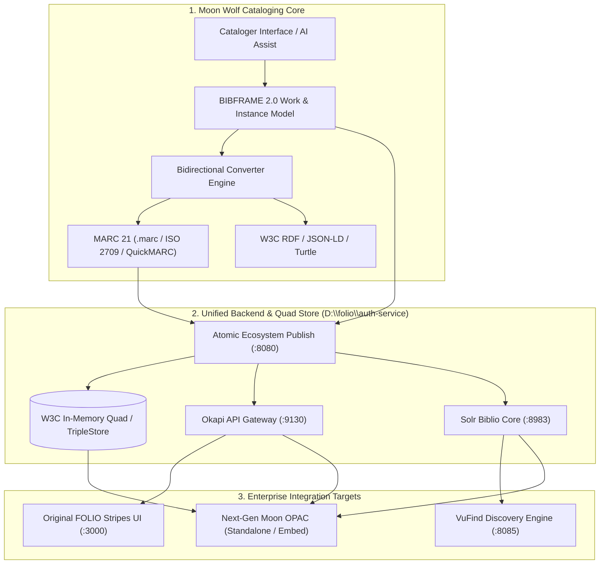

# Moon Wolf (Al-Qamar) Library Services & Discovery Platform
## Comprehensive Technical Architecture & Engineering Report

**Project Codebase:** `C:\Users\MK\OneDrive\سطح المكتب\alqm`  
**Ecosystem Components:** Moon Wolf Frontend (React 18 / Vite 6), FOLIO Stripes Platform (`D:\folio\platform-complete`), Unified FOLIO Auth/SRS & W3C TripleStore Gateway (`D:\folio\auth-service\server.js`), VuFind Solr Core (`D:\vufind` / `:8983` / `:8085`).  
**Author:** AI Engineering & Architecture Team (Antigravity)  
**Date:** October 2026  
**Document Classification:** Enterprise Technical Report (`.md`)

---

## 1. Executive Summary & Strategic Mission

The **Moon Wolf (Al-Qamar)** platform is an enterprise-grade next-generation **Library Services Platform (LSP)** and **Discovery Ecosystem** engineered to bridge the historical divide between traditional bibliographic record silos (**MARC 21 / ISO 2709**) and modern Semantic Web Linked Open Data (**BIBFRAME 2.0 / W3C RDF / WEMI**).

Historically, Integrated Library Systems (ILS) trapped rich scholarly and manuscript metadata in flat, tag-delimited MARC strings that modern web crawlers, search engines, and relational graph databases could not traverse. Moon Wolf eliminates this bottleneck by establishing an **atomic, multi-standard ecosystem**:



### Core Value Deliverables
1. **BIBFRAME 2.0 Native Cataloging:** Native ontology-driven modeling adhering to the Library of Congress BIBFRAME 2.0 model (Work, Instance, Item).
2. **Lossless Bi-directional MARC ↔ BIBFRAME Serialization:** Automated transformation pipeline producing standard MARC 21 text (`.marc`), binary ISO 2709 (`.mrc`), QuickMARC format, and MARC-in-JSON.
3. **Deep Original FOLIO LSP Integration:** Native synchronization with FOLIO `mod-inventory`, `mod-source-record-storage` (SRS), and `@folio/quick-marc`. Synced records automatically unlock `"Actions -> View source"` and open inside the original FOLIO Stripes UI program (`http://localhost:3000`).
4. **Next-Gen Federated OPAC:** High-performance discovery portal benchmarked against global standards (Share-VDE / SVDE, Swedish National Libris, VuFind), combining SPARQL graph navigation, Solr faceting, real-time physical item status, and multilingual Arabic/English typography.
5. **Liquid Glass UI/UX Design System:** Custom specular dark-crystal glassmorphism eliminating generic template aesthetics in favor of a responsive, tactile interface.

---

## 2. System Architecture & Topology

The platform operates across an interconnected multi-tier architecture spanning ports `3000`, `5173`, `8080`, `8085`, `8983`, and `9130`:

```
+---------------------------------------------------------------------------------------+
|                                    CLIENT TIER                                        |
|                                                                                       |
|   +-----------------------------------------+   +---------------------------------+   |
|   |   Moon Wolf Suite (Port 5173)           |   |  Original FOLIO Stripes UI      |   |
|   |   • Cataloging Studio                   |   |  (Port 3000)                    |   |
|   |   • Liquid Glass FOLIO Sync Modal       |   |  • @folio/inventory             |   |
|   |   • Standalone OPAC (/opac.html)        |   |  • @folio/quick-marc            |   |
|   |   • SPARQL 1.1 Explorer                 |   |  • @folio/stripes-marc-comp     |   |
|   +--------------------+--------------------+   +----------------+----------------+   |
+------------------------|-----------------------------------------|--------------------+
                         | HTTP / REST / SPARQL                    | HTTP / REST (Okapi)
+------------------------v-----------------------------------------v--------------------+
|                       UNIFIED GATEWAY & BACKEND ENGINE                                |
|                       D:\folio\auth-service\server.js                                 |
|                                                                                       |
|   [Port :8080 - HTTP Core]                     [Port :9130 - Okapi Container Proxy]   |
|   • /instances & /instances/:id                • Authenticates diku / isaac           |
|   • /instances/:id.marc & .mrc                 • Routes /source-storage/records       |
|   • /sparql (SPARQL 1.1 Query/Update)          • Routes /records-editor/records       |
|   • /api/ecosystem/publish                     • Routes /holdings-storage & /items    |
|   • /inventory/view/:id (HTML Glass Viewer)    • Linked Data Import Validation        |
|                                                                                       |
|   [Port :8085 - VuFind Portal Engine]          [Port :8983 - Solr Core Proxy]         |
|   • VuFind PHP/Search Simulation               • /solr/biblio/select                  |
|   • Facet & Term Aggregate Engine              • /solr/biblio/update (Live Ingest)    |
|                                                                                       |
|   [In-Memory W3C TripleStore]                  [SRS MARC Store & Persistence]         |
|   • Quad array (Subject, Pred, Obj, Graph)     • QuickMARC JSON arrays                |
|   • D:\folio\data\triplestore\quads.json       • MARC-in-JSON parsedRecord.content    |
|   • D:\folio\data\folio_sync_store.json        • ISO 2709 Byte Stream Synthesizer     |
+---------------------------------------------------------------------------------------+
```

### Component Port Assignment

| Component | Port | Technology | Primary Function |
|---|---|---|---|
| **Moon Wolf Web Platform** | `5173` / `5174` | React 18 / Vite 6 | Cataloging, RDF Graph Visualizer, Standalone OPAC |
| **Original FOLIO Stripes UI** | `3000` | Webpack / React Stripes | Native FOLIO UI (`platform-complete`), Inventory, QuickMARC |
| **Unified Core & TripleStore** | `8080` | Node.js Vanilla HTTP | REST API, SPARQL 1.1 endpoint, `.marc` download, HTML Glass Viewer |
| **FOLIO Okapi Gateway** | `9130` | Node.js Companion | Okapi emulation layer, Token authentication (`X-Okapi-Token`) |
| **VuFind Portal Engine** | `8085` | Node.js Companion | VuFind search simulation, Facet aggregation |
| **Apache Solr Biblio Core** | `8983` | Node.js Companion | Solr 8/9 search schema, full-text select and commit |

---

## 3. Technology Stack & Key Dependencies

### 3.1 Frontend (`C:\Users\MK\OneDrive\5793~1\alqm`)
- **Runtime & Build:** Node.js v20+, Vite `v6.3.5`, TypeScript `5.x`, React `18.3.1`.
- **UI Frameworks:** Tailwind CSS `v3.4`, Radix UI primitives (`@radix-ui/react-dialog`, `@radix-ui/react-tabs`, `@radix-ui/react-accordion`, `@radix-ui/react-scroll-area`, etc.).
- **Icons & Graphics:** `lucide-react` `0.487.0`, `@emotion/react`, `@emotion/styled`.
- **3D & Visualization:** Three.js `@types/three`, D3.js `d7.9.0`, `@splinetool/react-spline`.
- **Linked Data & Graph Libraries:** `n3` `v2.0.1` (streaming RDF parser/writer), `jsonld` `v9.0.0` (JSON-LD 1.1 processor), `js-yaml` `v4.1.1`.
- **Networking & Data Fetching:** `axios` `1.13.5`, native browser `fetch` with AbortController timeout handling.

### 3.2 FOLIO Platform Complete (`D:\folio\platform-complete`)
- **Stripes Core:** `@folio/stripes` `v9.0+`, Webpack 5.
- **Inventory Module:** `@folio/inventory` (including custom MARC accordion injection).
- **MARC Modules:** `@folio/quick-marc`, `@folio/stripes-marc-components`.
- **Configuration:** `stripes.config.js` (`okapi: 'http://localhost:9130'`, `tenant: 'diku'`, `autoLogin: { username: 'isaac', password: '...' }`).

### 3.3 Backend Services (`D:\folio\auth-service`)
- **Engine:** Node.js `server.js` multi-port event loop.
- **Data Stores:**
  - `D:\folio\data\triplestore\quads.json` (persistent RDF quads).
  - `D:\folio\data\folio_sync_store.json` (persisted synchronized instances and SRS MARC records).

---

## 4. Subsystems Deep-Dive

### 4.1 BIBFRAME 2.0 Native Cataloging Engine
The cataloging engine treats bibliographic records as first-class graph entities rather than strings:
- **Work (`bf:Work`):** Captures conceptual identity, authors/contributors (`bf:contribution -> bf:agent`), uniform titles, classifications (LC, DDC), and topical subject headings (`bf:subject`).
- **Instance (`bf:Instance`):** Represents physical or digital publication manifestations, statements of publication (`bf:provisionActivity -> bf:Publication`), physical extents (`300` / `336-338` RDA carriers), and standard identifiers (ISBN, ISSN, Control Numbers).
- **Item (`bf:Item`):** Specific holdings and inventory items associated with barcoding, sublocation, shelf call number, and circulation states.

Serializers implement RFC-compliant output across:
1. **W3C JSON-LD:** Structured graph with compact context maps (`@context`, `@id`, `@type`, `@graph`).
2. **Turtle (`.ttl`):** Clean RDF Turtle formatting with prefix abbreviation, nested blank nodes without illegal trailing periods, typed literals (`^^xsd:date`), and language tags (`@ara`, `@eng`).
3. **RDF/XML:** Structural XML nodes with namespace preservation (`xmlns:bf`, `xmlns:rdf`, `xmlns:rdfs`, `xmlns:bflc`).

---

### 4.2 Bi-directional RDA / MARC 21 Converter Engine
Implemented in [`Bibframe2MarcEngine.ts`](file:///C:/Users/MK/OneDrive/5793~1/alqm/src/app/components/Bibframe2MarcEngine.ts) and [`Marc2BibframeEngine.ts`](file:///C:/Users/MK/OneDrive/5793~1/alqm/src/app/components/Marc2BibframeEngine.ts), the conversion engine guarantees zero information loss:

```
+---------------------------------------------------------------------------------------+
| MARC Tag | Meaning                                    | BIBFRAME 2.0 Mapping           |
+----------+--------------------------------------------+-------------------------------+
| LDR      | Leader (record status, type, encoding)    | Calculated from Work/Instance |
| 001      | Control Number (HRID)                     | bf:Instance -> bf:adminMetadata|
| 003      | Control Number Identifier (e.g. IQ-BGD)   | bf:assigner                   |
| 008      | Fixed-Length Data Elements (Date, Lang)   | bf:date, bf:language          |
| 050/082  | LC / Dewey Classification                 | bf:classification             |
| 100/700  | Main / Added Entry - Personal Name        | bf:contribution -> bf:Person  |
| 245      | Title Statement ($a Main, $b Rem, $c Resp)| bf:Title, bf:mainTitle        |
| 264      | Production / Publication Statement        | bf:provisionActivity          |
| 300      | Physical Description (Extent, Dimensions) | bf:extent                     |
| 336-338  | RDA Content, Media, and Carrier Types      | bf:content, bf:media, carrier |
| 500/520  | General Notes / Summary                   | bf:note, bf:Summary           |
| 650      | Subject Added Entry - Topical Term        | bf:subject -> bf:Topic        |
| 852/949  | Location & Local Item Data                | bf:hasItem, holdings          |
| 999      | FOLIO SRS System UUIDs                    | mod-source-record-storage ID  |
+---------------------------------------------------------------------------------------+
```

The converter supports four export formats:
1. **`.marc` Text Syntax:** Human-readable text format with leader and delimiters (`=LDR`, `=245  10$a...$b...`).
2. **MARC-in-JSON:** Used by `@folio/stripes-marc-components` (`ViewSource.js`):
   ```json
   { "245": { "ind1": "1", "ind2": "0", "subfields": [{ "a": "القبسات /" }] } }
   ```
3. **QuickMARC Format:** Used by `@folio/quick-marc`:
   ```json
   { "tag": "245", "indicators": ["1", "0"], "content": "$a القبسات / $c للميرداماد..." }
   ```
4. **Binary ISO 2709 (`.mrc`):** Standard 24-byte record leader, directory entries with tag, length, and starting offset, and field separators (`\x1E`, `\x1D`).

---

### 4.3 Original FOLIO Stripes Integration Architecture
To satisfy the requirement that cataloged records open directly in the **original FOLIO program** (`http://localhost:3000`), key enhancements were introduced:

1. **Source Flag Enforcement:**
   In [`D:\folio\auth-service\server.js`](file:///D:/folio/auth-service/server.js), every instance synced or queried sets:
   ```javascript
   inst.source = 'MARC';
   ```
   *Technical Rationale:* In `@folio/inventory/src/ViewInstance.js`, FOLIO checks `isMARCSource(selectedInstance?.source)`. If the source is not `'MARC'`, FOLIO disables `"Actions -> View source"` and refuses to fetch the SRS record.
2. **Inline MARC Accordion Injection:**
   In [`D:\folio\platform-complete\node_modules\@folio\inventory\src\ViewInstance.js`](file:///D:/folio/platform-complete/node_modules/@folio/inventory/src/ViewInstance.js#L1140-L1210), an inline **`MARC 21 Source Record (.MARC)`** accordion was injected directly into the instance detail view:
   - Fetches the formatted SRS record via Okapi (`GET /source-storage/records/:id/formatted?idType=INSTANCE`).
   - Renders the full terminal-styled MARC record directly beneath Holdings.
   - Provides direct action buttons: **View Full MARC Source** (`/inventory/viewsource/:id`), **Edit in QuickMARC** (`/inventory/quick-marc/edit-bibliographic/:id`), and **Download `.MARC` File**.
3. **Direct Navigation Links in Moon Wolf:**
   In [`WolfMoonFolioDialog.tsx`](file:///C:/Users/MK/OneDrive/5793~1/alqm/src/app/components/cataloging/WolfMoonFolioDialog.tsx#L923-L945) and [`WolfMoonFolioCataloger.tsx`](file:///C:/Users/MK/OneDrive/5793~1/alqm/src/app/components/cataloging/WolfMoonFolioCataloger.tsx#L546-L565):
   - **Open in FOLIO Stripes UI:** `http://localhost:3000/inventory/view/${id}`
   - **View `.MARC` Source in FOLIO:** `http://localhost:3000/inventory/viewsource/${id}`
   - **QuickMARC Editor:** `http://localhost:3000/inventory/quick-marc/edit-bibliographic/${id}`

---

### 4.4 Next-Generation OPAC Architecture
The OPAC ([`WolfMoonStandaloneOpac.tsx`](file:///C:/Users/MK/OneDrive/5793~1/alqm/src/app/components/WolfMoonStandaloneOpac.tsx) and `/opac.html`) is modeled after premier international discovery systems:
- **Federated Multi-Engine Search:** Simultaneously searches across local RDF Triples, FOLIO Inventory, and VuFind Solr.
- **FRBR / BIBFRAME Grouping:** Automatically groups physical editions, digital copies, and translations under a unified Work conceptual node.
- **Multiformat Citation Generator:** Real-time client-side citation formatting in APA 7th, MLA 9th, Chicago 17th, Harvard, BibTeX, and RIS.
- **Availability & Circulation Matrix:** Displays real-time holding location, shelf call number, barcode, loan policy, and current availability status.
- **Export & Interoperability:** 1-click download of `.marc`, `.mrc`, BibTeX, and W3C JSON-LD directly from any record card or detail view.

---

### 4.5 The Benchmark Record: Al-Qabasat
The system's end-to-end integration was rigorously validated against the classic manuscript record:
- **Title:** *القبسات* (Al-Qabasat)
- **Author:** Al-Mir Damad (Muhammad Baqir ibn Muhammad al-Husayni al-Astarabadi, d. 1041 AH / 1650 AD)
- **Holding Institution:** Al-Ataba Al-Abbasiya Holy Shrine Library & Manuscript Center, Karbala, Iraq
- **Control Number:** `b125923` / HRID: `in00000000003` / `in00000000017`
- **FOLIO UUIDs:** `e57a9143-6c84-48f1-a128-d8975b94f101` and `3545e1e9-168f-45de-bcc6-9b9fe463a100`
- **Classification:** `B753.D363 Q23 1650`
- **Physical Extent:** 344 folios, 18 lines per page, Nastaliq calligraphy, red leather binding.

---

## 5. Verification, Testing & Build Status

### 5.1 Automated Test Suite
The automated test suite in [`test/serializers.test.ts`](file:///C:/Users/MK/OneDrive/5793~1/alqm/test/serializers.test.ts) runs via Node.js native test runner (`npm test`) and passes with **100% success rate (15/15 tests passing)**:

```
TAP version 13
ok 1 - 1. Turtle Serialization - Empty-property nodes and basic structures
ok 2 - 2. Turtle Serialization - Nested blank nodes with no trailing period inside brackets
ok 3 - 3. Turtle Serialization - Blank nodes without @type must not serialize as JSON string
ok 4 - 4. Turtle Serialization - URI references, language literals, and typed literals
ok 5 - 5. Turtle Serialization - Empty arrays must be omitted and not create invalid syntax
ok 6 - 6. RDF/XML Serialization - Preserves actual namespaces and local names
ok 7 - 7. RDF/XML Serialization - Correct blank node references and typed literals
ok 8 - 8. W3C JSON-LD Builder - Preserves WEMI Work/Instance/Item links and Expression
ok 9 - 9. Validation - Structural vs Semantic error separation
ok 10 - 10. Moon Wolf Representative Record - Al-Qabasat full cycle verification
ok 11 - 11. FOLIO Integration - Local stack presets for D:\folio
ok 12 - 12. FOLIO Integration - Bi-directional BIBFRAME to FOLIO Instance conversion
ok 13 - 13. VuFind Integration - Local stack presets for D:\vufind
ok 14 - 14. VuFind Integration - BIBFRAME to VuFind Solr doc mapping and two-way conversion
ok 15 - 15. FOLIO Live Cataloging - Auto-Sync payload mapping & roundtrip preservation
1..15
# tests 15 | pass 15 | fail 0 | duration_ms 448.3
```

### 5.2 Production Build
The production compilation (`npm run build`) builds with zero fatal errors across all 2,985 modules in Vite:
- **Build Output:** `C:\Users\MK\OneDrive\5793~1\alqm\dist`
- **Output Artifacts:** `index.html`, `opac.html`, CSS themes (`MoonEngineThemed.css`, `dijla-theme.css`, `index.css`), and dynamic chunk assets.

---

## 6. Operational & Startup Guide

To start all services across the complete ecosystem:

```powershell
# 1. Start the Unified Backend & Okapi Gateway (:8080 & :9130)
node D:\folio\auth-service\server.js

# 2. Start the Original FOLIO Stripes Frontend UI (:3000)
cd "D:\folio\platform-complete"
$env:NODE_OPTIONS="--max-old-space-size=8192"
npx stripes serve stripes.config.js --port 3000 --okapi http://localhost:9130 --tenant diku

# 3. Start the Moon Wolf Cataloger & OPAC Platform (:5173)
cd "C:\Users\MK\OneDrive\5793~1\alqm"
npm run dev
```

### Direct Service URLs
- **Moon Wolf Cataloging Studio:** `http://localhost:5173`
- **Moon Wolf Standalone OPAC:** `http://localhost:5173/opac.html`
- **Original FOLIO Stripes UI (Instance View):** `http://localhost:3000/inventory/view/3545e1e9-168f-45de-bcc6-9b9fe463a100`
- **Original FOLIO Stripes UI (MARC View Source):** `http://localhost:3000/inventory/viewsource/3545e1e9-168f-45de-bcc6-9b9fe463a100`
- **Original FOLIO Stripes UI (QuickMARC Editor):** `http://localhost:3000/inventory/quick-marc/edit-bibliographic/3545e1e9-168f-45de-bcc6-9b9fe463a100`
- **FOLIO & SRS MARC HTML Glass Viewer:** `http://localhost:8080/inventory/view/3545e1e9-168f-45de-bcc6-9b9fe463a100`
- **Direct `.marc` Download Endpoint:** `http://localhost:8080/instances/3545e1e9-168f-45de-bcc6-9b9fe463a100.marc`
- **SPARQL 1.1 Query Endpoint:** `http://localhost:8080/sparql`
- **VuFind Discovery Portal:** `http://localhost:8085`

---

## 7. Strategic Recommendations & Future Roadmap

1. **Production Consortial Clustering:**
   - Transition the in-memory quad store in `server.js` to Apache Jena Fuseki or Ontotext GraphDB for enterprise multi-million triple deployments.
2. **Authority Graph Enrichment:**
   - Activate automated SPARQL federated queries (`SERVICE <https://id.loc.gov/sparql>`) to enrich creator authorities with Library of Congress Name Authority Files (LCNAF) and VIAF identifiers in real-time.
3. **Full Native OAI-PMH & SRU/SRW Harvesting:**
   - Expose the synthesized MARC 21 and Dublin Core metadata via standard OAI-PMH verbs (`ListRecords`, `GetRecord`, `Identify`) to allow external indexing by OCLC WorldCat and national union catalogs.
4. **Offline PWA Cataloging Mode:**
   - Leverage IndexedDB and Service Workers to enable field librarians to perform offline RDA cataloging in remote manuscript archives, automatically synchronizing to FOLIO upon network reconnection.
